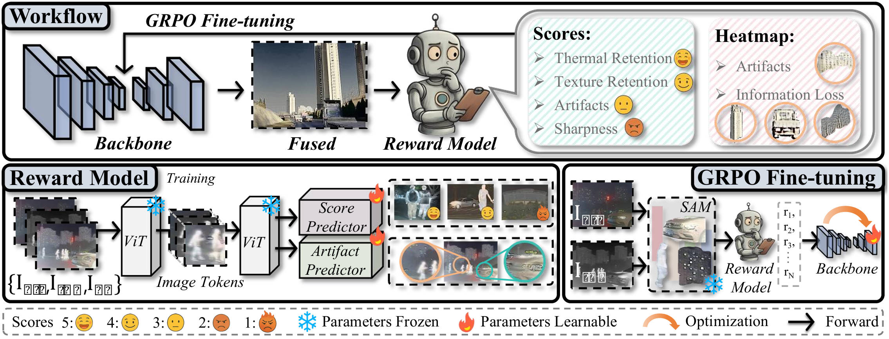

# EVAFusion

论文：**Bridging Human Evaluation to Infrared and Visible Image Fusion**。

本项目已恢复奖励模型训练、SAM+GRPO 微调 IVIF 与融合推理。当前 SAM+GRPO 保留论文的同图语义区域优势与裁剪目标，将输出变化比率明确修订为随机策略概率比率；不宣称逐公式复现或已复现论文完整指标。



## 环境

当前项目内 `.venv` 已安装用于验证的 **Python 3.12 / PyTorch 2.5.1 CPU** 环境。以下 PowerShell 命令在项目根目录执行；GPU 训练需先在所用环境安装匹配的 PyTorch / torchvision 构建。

新环境可在安装 PyTorch 后执行：

```powershell
python -m pip install -r requirements.txt
```

`environment.yml` 保留上游 Linux 环境记录；当前 Windows 使用 `requirements.txt`。`requirements-verified-cpu.txt` 记录本次验证环境的精确版本。

## 本地资源

奖励权重和融合权重保存在本项目；ViT、训练数据和测试图像默认读取同级 `RLHF-Fusion`：

| 资源 | 默认位置（相对 `RLHF-Fusion`） |
|---|---|
| ViT 与图像处理器 | `RichHF/vit-large-patch16-384/` |
| 奖励 train/dev/test 数据 | `RichHF/data/train/`、`dev/`、`test/` |
| MSRS 训练补丁 | `DCEvo-main/data/MSRS_train_imgsize_128_stride_200.h5` |
| 融合测试数据 | `DCEvo-main/datasets/` |

训练代码默认加载 `reward_model/20250503_232931/model_best.pt`（约 3 GB）。GitHub 上使用 Git LFS 保存奖励权重分片与 SAM 权重；克隆后执行以下命令下载并还原奖励权重，工具会校验分片及最终文件的 SHA-256，不覆盖不同内容的已有权重：

```powershell
git lfs install
git lfs pull
python -m reward_model.restore_checkpoint
```

最终融合权重位于 `models/DCEvo/DCEvo_epoch10_2025-07-25_07-47-21.pth`，原始融合初始化权重为 `ckpt/DCEvo_fusion.pth`。恢复后的单文件奖励权重作为本地产物忽略，分片与校验清单随仓库保存。

若移动了原目录，可复制 `configs/local.example.json` 为 `configs/local.json`，修改 `source_root`，在命令中加入 `--config configs/local.json`。也可以直接通过各命令的路径参数指定资源；配置内的相对路径均以项目根目录为基准。这里复用的外部目录需要保留。

上游提供的数据集地址：[HHOODD/EVAFusion_dataset](https://huggingface.co/datasets/HHOODD/EVAFusion_dataset)。本次恢复使用本地已有数据。

## Stage 1：训练奖励模型

```powershell
.\.venv\Scripts\python.exe train_reward.py --device cpu --num_epochs 30 --batch_size 4
```

默认启用五个独立评分头，按照原始配方冻结共享 ViT 和融合 ViT，优化评分头、热图头及投影层。输出在 `outputs/reward_training/<时间戳>/`，包含 `model.pt`、`model_best.pt`、配置、验证指标与源代码快照。

常用参数：`--vit_model`、`--train_path`、`--dev_path`、`--num_workers`、`--log_dir`、`--ckpt`。`--single-head` 仅供读取/对照旧实验，单头会共享五项评分输出，不适合新的多维评分训练。

评估奖励模型并导出每张图的分数和伪影热图：

```powershell
.\.venv\Scripts\python.exe -m RichHF.inference --device cpu --limit 2 --eval --infer --output-dir outputs/reward
```

使用新训练的奖励模型时增加 `--checkpoint <model_best.pt路径>`；`--split` 可选 `train`、`dev`、`test`。兼容入口 `python reward_model/inference.py` 使用相同参数。

## Stage 2：SAM + GRPO 微调

IVIF 微调只保留 `training/finetune.py` 一个入口，使用模块方式启动。项目内已安装官方固定提交的 SAM，并准备 `ckpt/sam_vit_b_01ec64.pth`；其他环境安装 `requirements-sam.txt`，再准备相应权重。

```powershell
.\.venv\Scripts\python.exe -m training.finetune --device cpu --epochs 1 --max-steps 1 --batch-size 1 --max-regions 3 --weight-decay 0 --output-dir outputs/sam_grpo_diagnostic
```

当前采用 **SAM + 随机策略 GRPO**：从 DCEvo 输出 logits 的固定方差高斯策略采样融合图，用 SAM 分区后，在**同一张采样融合图的多个语义区域之间**计算优势。默认每对输入采样 1 张图，`--samples-per-input` 只控制重复采样次数，不改变优势分组。默认最多 3 个区域、均匀区域权重、每轮 2 次更新、epsilon=0.2、KL 系数 0.1。

**与论文的对应：保留式 (3) 的跨区域优势、式 (5) 的裁剪形式以及冻结参考策略；将输出绝对变化比率明确修订为真实区域动作概率比率，KL 使用同一高斯策略的精确解析式。** 这是论文框架下的修订实现，不宣称逐公式复现。没有直接奖励反向传播或额外融合辅助损失。

每轮固定采样动作、SAM 掩码、旧策略、奖励与优势；初始参考网络和奖励模型始终冻结。全图分数记录更新前后确定性融合图的奖励，只用于监测。默认使用与奖励训练一致的 `--reward-preprocess processor`。无区域时报错；单区域或所有区域同分时优势为零，不能计作成功启动。`--mask-source h5` 仅用于真实预计算语义掩码；显式全图回退会记录，并不能制造语义优势。

新增参数包括 `--policy-std 0.1`（logit 单位）、`--samples-per-input 1`、`--target-kl 0.02`、`--max-backtracks 16`、`--advantage-eps` 和 `--score-batch-size`。超过旧策略 KL 上限时回滚参数及 Adam 状态并减小本步学习率；重试耗尽时报错。旧 `--ratio-alpha`、`--ratio-denominator-eps`、`--kl-temperature`、`--group-size` 和辅助损失参数不再接受。

上述命令关闭权重衰减，用于验证真实策略梯度；正式默认权重衰减仍为 0.01。输出 `final.pth` 可直接用于 `test_Fusion.py --checkpoint`，推理仍输出确定性融合图，无需 SAM 或奖励模型。

策略定义为 `z~Normal(DCEvo_logits,sigma²I)`、`F=sigmoid(z)`。对每张采样融合图的有效 SAM 区域评分，按区域维度计算 `A_k=(s_k-mean(s))/(std(s)+eps)`；固定采样动作、掩码与优势，用区域内 log 概率之和构造 `r_k=exp(sum(log pi_current-log pi_old))`。目标为区域加权的裁剪优势加同方差高斯策略到初始参考网络的解析 KL。重叠掩码对应区域边际目标，不声称其是全图期望奖励的无偏梯度。

## 融合推理

```powershell
.\.venv\Scripts\python.exe test_Fusion.py --device cpu --datasets M3FD TNO RoadScene --output-dir outputs/fusion
```

快速验证（缩放后的指标仅用于检查运行，不用于复现论文）：

```powershell
.\.venv\Scripts\python.exe test_Fusion.py --device cpu --datasets TNO --limit 1 --resize 128 128
```

使用新微调模型或自己的成对图像：

```powershell
.\.venv\Scripts\python.exe test_Fusion.py --device cpu --checkpoint outputs/sam_grpo_diagnostic/final.pth --ir-dir <红外目录> --vi-dir <可见光目录> --output-dir outputs/custom
```

图像按文件名配对。推理输出包含融合 PNG 与 CC、PSNR、SSIM、Qabf；计算逻辑统一调用 `Metric/metrics.py`。**推理 PSNR 默认恢复原实验 `Metric_torch.py::PSNR_function` 口径**：图像除以 255，先平均两张源图的归一化 MSE，再计算 `20*log10(255/sqrt(MSE))`，对应历史约 60 dB 的数值量级。它比同一 MSE 的常规 PSNR 高约 48.13 dB；CC、SSIM、Qabf 与图像保存方式不变。结果 JSON 记录 `psnr_mode`，也可通过 `--psnr-mode mean-db/mean-mse` 选择常规口径。完整指标使用下方离线评测入口。

## 指标评测

`Metric/evaluate.py` 默认计算 CC、PSNR、Qabf、SSIM、NIQE、BRISQUE，另支持 EN、SD、SF、AG、MI、SCD、MSE、VIF、MS_SSIM。详细定义、参数、无效值处理和依赖见 [Metric 使用说明](Metric/README.md)。

```powershell
# 新环境先安装指标依赖；当前 .venv 已安装。
python -m pip install -r Metric/requirements.txt

# 读取已保存的融合结果，输出逐图和汇总 CSV/JSON。
.\.venv\Scripts\python.exe -m Metric.evaluate --fused-root outputs/fusion --datasets M3FD TNO RoadScene --output-dir outputs/metrics
```

离线评测默认仍用常规 PSNR。若需与推理的历史口径一致，增加 `--psnr-mode legacy-normalized-255`。

单个目录使用 `--ir-dir`、`--vi-dir`、`--fused-dir`；`--metrics` 选择指标。文件名忽略扩展名配对，尺寸必须一致，不自动缩放。NIQE/BRISQUE 参数已保存在 `Metric/assets/`，评测时无需下载。Qabf 的梯度强度比保持 min/max，PSNR 模式显式记录。历史 PSNR 对应原实验归一化 MSE/峰值 255 公式，是否复现论文整表仍取决于权重、样本及其他协议。

## 数据准备工具

已有本地 Arrow/HDF5 数据可直接使用，无需重建。

```powershell
# 从圆形伪影标注生成热图，空标注也生成全黑标签。
.\.venv\Scripts\python.exe -m RichHF.get_heatmap --annotations <Annotation目录> --images <fused目录> --output <heatmap/Artifacts目录>

# 按原 Annotation/ir/vi/fused/heatmap/Artifacts 结构保存一个固定数据划分。
.\.venv\Scripts\python.exe -m RichHF.IVIF_get_dataset --dataset-dir <划分目录> --split train --output <新的数据目录>

# 为新的成对图像生成普通微调补丁，不生成或伪造 SAM 掩码。
.\.venv\Scripts\python.exe prepare_fusion_data.py --ir-dir <红外目录> --vi-dir <可见光目录> --output <新文件.h5> --patch-size 128 --stride 200
```

HDF5 读取支持 `ir_patchs/vis_patchs` 和每样本 `vis/ir/mask_*` 两种格式，兼容 CPU 和 Windows DataLoader。新建 HDF5 工具采用固定网格并丢弃不完整边缘；不是对历史数据采样清单的还原。

## 验证

```powershell
.\.venv\Scripts\python.exe -m unittest discover -s tests -v
```

正式测试覆盖真实概率比率与解析 KL、同图区域优势、首步策略梯度、Adam 完整回滚、冻结状态、CLI、奖励训练、指标和推理。`utils/grpo.py` 保留字面公式的零梯度测试作为对照，实际训练使用 `utils/stochastic_grpo.py`。真实 CPU SAM/奖励模型诊断选中 3 个语义区域，关闭权重衰减后的两次更新均测得非零策略梯度并通过 KL 检查；实际接受学习率较小，完整训练效率与质量仍需验证。没有进行完整重训练、GPU 多卡验证或论文表格复现。

## Citation

```bibtex
@article{liu2026bridging,
  title={Bridging Human Evaluation to Infrared and Visible Image Fusion},
  author={Liu, Jinyuan and Li, Xingyuan and Mei, Qingyun and Xu, Haoyuan and Jiang, Zhiying and Ma, Long and Liu, Risheng and Fan, Xin},
  journal={arXiv preprint arXiv:2603.03871},
  year={2026}
}
```
